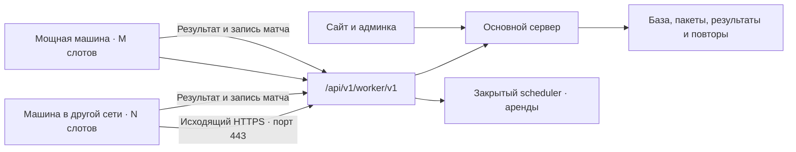

# Подключение внешних воркеров «Арены»

Реализация от 13 ноября 2026 года. Машины могут находиться в другой сети: достаточно исходящего HTTPS-доступа к «Арене». VPN, белый IP и входящие порты не нужны.

## Подключить машину

1. Администратор открывает **Система → Исполнители запусков → Добавить машину** (`/admin/game-sources`).
2. Указывает название, число параллельных матчей (1–64), при необходимости метки: по одной `имя=значение` на строку.
3. Копирует команду и выполняет её в терминале машины с Docker. Основной вариант — Linux с работающим Docker Engine; поддержаны amd64 и arm64.
4. Команда собирает образ из версионного архива исходников, который выдаёт сама «Арена», скачивает образ игрового движка и запускает контейнер. Адреса вымышленного registry нет; первая сборка требует доступа к Docker Hub, пакетным репозиториям и download.docker.com.
5. Машина появляется онлайн и забирает подходящие задания в свободные слоты.

Одноразовый ключ действует 30 минут и показывается только в команде подключения. Если сборка заняла дольше, получите новую команду. Повтор обмена тем же ключом и тем же предложенным токеном допустим после потери ответа; другая машина с другим токеном уже не подключится этим ключом.

Долговременный токен генерирует воркер до обмена, сохраняет в именованном Docker volume `/var/lib/arena-worker` с правами 0600. Сервер сохраняет только хеши ключа и токена. После перезапуска контейнер использует сохранённый токен; срок одноразового ключа на него не влияет. Долговременный токен в интерфейс и список машин не возвращается.

Команда использует стандартный Docker socket `/var/run/docker.sock`. Управляющий контейнер получает доступ к Docker этой машины: подключать следует только свои доверенные машины. Игровые контейнеры не получают ни socket, ни ключ подключения, ни токен машины.

## Схема

Сайт, очередь, база и повторы остаются на сервере. Внешним машинам не нужны адреса внутренних сервисов, доступ к Redis/PostgreSQL и общий `INTERNAL_API_TOKEN`. Scheduler по-прежнему находится в закрытой сети. API для внешних машин проверяет отдельный bearer-токен, привязанный к конкретному узлу.

Один слот считает один матч целиком, включая ботов всех участников. Подбор учитывает метки, назначенные администратором; машина не выбирает себе чужой ID, дополнительные слоты или метки через запрос. Ограничение числа аренд проверяется атомарно в Redis.

## Выполнение и обрывы связи

- Воркеры сами регистрируются, отправляют heartbeat, получают задания, скачивают пакеты и отправляют результаты. Смена внешнего IP не требует переподключения.
- Выдача ждёт до 10 секунд при пустой очереди. Heartbeat и контроль уже выполняемых матчей проходят отдельными запросами.
- Для внешних машин аренда выдаётся на 90 секунд. Продление сохраняет этот срок; внутренние исполнители продолжают использовать прежний срок по умолчанию.
- До выдачи исходников backend закрепляет запуск за машиной и поколением аренды. Доступ к коду, игровому пакету, управлению и результату требует токен этой машины и действующий `X-Lease-Id`.
- Пакет игры проверяется по SHA-256 и кешируется; код и seed зафиксированы для задания. Engine работает в отдельном Docker-контейнере с отключённой сетью, ограничениями CPU, памяти, процессов и времени.
- Если машина пропала, аренда истекает, задание возвращается в очередь. Поздний результат прежней аренды отвергается. Сетевая ошибка не должна становиться ошибкой кода ученика.
- Повторная отправка уже принятого результата подтверждает существующий итог и не заменяет его другим payload. Очки и статистика не начисляются повторно.
- Повторы запросов используют увеличение задержки. TLS проверяется штатно; отключать проверку сертификата для установки не требуется. Токены не передаются в URL.

Результат ограничен 32 МБ. На обоих reverse proxy — внутри frontend и на внешнем nginx — для `/api/v1/worker/v1/` нужен `client_max_body_size 32m` и таймаут не меньше 45 секунд. Пример внешнего proxy находится в `deploy/nginx-site.conf`.

## Управление в админке

Список показывает название машины, подключение/состояние токена, присутствие, свободные/всего слотов и метки. После 45 секунд без heartbeat внешняя машина показывается офлайн. Обновление списка — раз в три секунды.

Действия находятся в меню «⋯»:

- **Завершает** (`draining`): закончить текущие задания, новые не брать.
- **Отключен** (`disabled`): запретить работу до включения администратором; выполняющийся контейнер остановится при следующей проверке управления.
- **Отозвать токен**: немедленно закрыть доступ этому токену и ключу подключения. Незавершённые задания подберут другие машины после истечения аренды.
- **Переподключить машину**: отозвать прежнее подключение и выдать новый одноразовый ключ с командой текущей версии. Команда заменяет управляющий контейнер, сохраняя его volume, и обменивает новый ключ на новый токен.

Ученик и преподаватель не управляют исполнителями. Они видят обычные состояния запуска и результат; выбор конкретной машины им не нужен.

## Обновление и ограничения

Архив Docker build context содержит только Dockerfile, описание зависимостей и исходники воркера. Его URL и тег образа содержат SHA-256 архива. Игровые пакеты, `.env`, тестовые данные и серверные ключи в него не входят. Это фиксация исходников воркера, а не полный lock всех внешних зависимостей. Для обновления используется новая команда подключения из админки.

Число слотов нужно выбирать по расходу CPU и памяти реальных игр. Внешние машины разгружают симуляцию, но не снимают ограничения основного API, базы и хранения кадров. Автоматическое создание машин, подробные графики загрузки и публичный пул недоверенных компьютеров в эту реализацию не входят.

## Код

- `execution/api/remote_workers.py` — административные операции и ограниченный HTTPS API.
- `execution/application/remote_workers.py` — ключи подключения и отзыв токенов.
- `execution/infrastructure/remote_workers.py` — память/SQL, атомарный обмен ключа.
- `execution/infrastructure/worker_distribution.py` — архив и команда Docker.
- `services/worker/src/worker_service/remote.py` — транспорт и сохранение токена.
- `0020_remote_workers` — отдельная таблица хешей; существующие внутренние воркеры продолжают работать.
