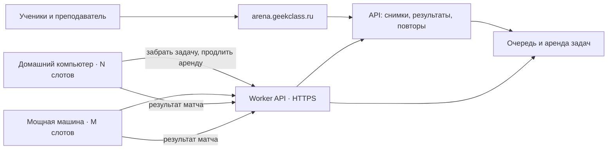

# Внешние воркеры «Арены»

Концепция от 13 ноября 2026 года. Обязательное условие: машины могут находиться в другой сети и подключаются через интернет с первого этапа. Это предложение по удобному подключению машин, с проверкой существующего кода. Новая регистрация и публичный worker API пока не реализованы.

## Что уже есть

Вычисления уже отделены от сайта: `services/worker` сам запрашивает задания у scheduler, получает снимки кода и игровой пакет от backend, запускает матч и отправляет результат обратно. Один слот исполняет один матч целиком, включая ботов всех участников. Браузеры смотрят сохранённую визуализацию; отдельный просмотр не требует повторного расчёта.

Реализованы:

- несколько параллельных слотов через `MAX_SLOTS` и автоматический опрос через `AUTO_POLL_ENABLED=true`;
- регистрация, heartbeat, состояния `online`, `draining`, `disabled`;
- аренда задания (`lease_id`), продление, возврат заданий после истечения аренды и проверка устаревшего результата;
- подбор по `worker_labels` и требованиям игровой версии;
- зафиксированный игровой пакет, снимки исходников и seed матча;
- запуск внутри Docker с ограничениями CPU, памяти, числа процессов, времени и сети.

Исходники: [воркер](../services/worker/src/worker_service/main.py), [его настройки](../services/worker/src/worker_service/settings.py), [scheduler](../services/scheduler/src/scheduler_service/main.py), [аренда и очередь](../services/scheduler/src/scheduler_service/queue.py).

Сейчас воркер обращается к двум адресам — `BACKEND_API_URL` и `SCHEDULER_URL`. Backend использует общий `INTERNAL_API_TOKEN`, а scheduler рассчитывает на закрытую сеть. Поэтому текущий scheduler нельзя просто опубликовать в интернете. Старый пример с общим сервисным токеном подходит только для доверенного закрытого контура.

## Предлагаемая схема

На основном сервере остаются сайт, API, база, очередь, пакеты игр и повторы. Внешние машины выполняют расчёт. Для них достаточно исходящих HTTPS-подключений к серверу по порту 443; открывать входящие порты на домашних машинах не нужно. Белый IP, общая локальная сеть и VPN не требуются. Прямого доступа воркеров к PostgreSQL, Redis и Docker сервера не будет.

С первого пилота используется один адрес `https://arena.geekclass.ru/worker/v1`, за которым сервер сам обращается к очереди и хранилищу. Он публикует только необходимые операции воркера, а не весь `/internal`. Текущие два внутренних адреса остаются деталями серверной реализации и внешним машинам не выдаются. При пустой очереди запрос выдачи сможет ожидать задание на сервере (long polling), чтобы десятки свободных слотов не опрашивали API каждую секунду.

## Работа через интернет

Воркеры инициируют все соединения сами: регистрацию, получение задания, heartbeat, продление аренды, скачивание файлов и отправку результата. Постоянное входящее соединение с машиной не требуется. Это позволяет запускать их за домашним роутером, NAT или CGNAT и менять внешний IP без повторной регистрации. Адрес и порт API машины на сервере не сохраняются как способ управления ею.

Сертификат HTTPS проверяется стандартно; отключение проверки TLS не входит в установку. Токен передаётся в заголовке авторизации, не в URL. Выдача задания ожидает ограниченное время, меньше таймаута reverse proxy, затем воркер повторяет запрос. При сетевых ошибках — повтор с увеличением задержки и случайным разбросом. Heartbeat и продление действующей аренды не должны ждать освобождения запроса выдачи.

Сроки аренды и таймауты настраиваются отдельно от лимита выполнения игры. Их подбираем на пилоте с учётом задержек интернета и загрузки результата; истечение аренды определяет сервер. Если результат уже отправлен, а ответ потерялся, повтор с тем же идентификатором возвращает подтверждение принятого результата. После потери аренды машина не выдаёт старый результат за результат новой попытки.

## Подключение машины как runner

1. Администратор открывает «Система → Исполнители → Добавить машину», задаёт имя, число слотов и при необходимости метки.
2. Получает команду запуска Docker Compose с короткоживущим одноразовым ключом подключения.
3. Машина обменивает этот ключ на собственный токен и появляется в списке исполнителей.
4. Пока есть свободные слоты, она забирает задачи. После выполнения отправляет результат и берёт следующую.

Это новый предлагаемый интерфейс. Публикацию версионного образа и готовую команду установки ещё нужно добавить; фиктивный адрес Docker-образа не считается готовым способом запуска.

На машине хранятся только её токен и настройки. Сервер хранит хеш токена. Токен можно отозвать независимо от остальных машин. Он разрешает получать задания только для своего узла, скачивать файлы действующей аренды и отправлять её результат; не даёт доступа к ученикам, каталогу и чужим запускам. Администратор машины считается доверенным: у него есть доступ к исходникам выполняемых ботов и возможность подменить вычисленный результат. Произвольные публичные компьютеры к этому пулу не подключаются.

## Задание и результат

Выдаваемое задание содержит идентификатор матча, номер попытки, идентификатор аренды, срок её действия, seed, ссылки на снимки кода и пакет игры с контрольной суммой, лимиты ресурсов и формат результата. Идентификатор воркера определяется токеном, а не произвольным полем запроса.

Воркер скачивает пакет по контрольной сумме и кеширует его. Для одинакового пакета повторное скачивание не нужно. Engine запускается в отдельном контейнере: без токена воркера, доступа к Docker socket и файлов основной системы. Токен остаётся в управляющем процессе воркера.

Пока идёт матч, воркер продлевает аренду и проверяет отмену. Результат содержит итог, события и кадры повтора. Backend проверяет владельца и поколение аренды, состав участников, формат и размер результата перед сохранением.

Выполнение допускает повтор после сбоя. Сохранение результата должно быть идемпотентным: повторная отправка принятого результата не добавляет очки второй раз. Поздний результат от машины с истёкшей арендой не заменяет результат новой попытки. Нельзя обещать строго однократное исполнение задачи при обрывах сети; требуется однократное принятие актуального результата.

## Отключения и нагрузка

- При коротком обрыве сети воркер повторяет запросы. После потери аренды прекращает исполнение; scheduler возвращает задачу в очередь.
- При засыпании компьютера или выключении контейнера незавершённые задачи после истечения аренды подбирают другие машины.
- «Дождаться завершения и отключить» переводит машину в `draining`: текущие задачи заканчиваются, новые не выдаются.
- «Отключить» запрещает новые выдачи; принудительный отзыв токена требует прекращения действующих аренд. Приоритет этой операции нужно проверить сквозным тестом.
- Если доступных машин нет, задания остаются в очереди. Пользователь видит ожидание вычислений, а не ошибку своего кода.

Число слотов выбирается по измеренному расходу CPU и памяти одного матча. Мощную машину можно использовать как один воркер с несколькими слотами; несколько компьютеров — как несколько воркеров. Нужен запас ресурсов для системы, Docker и передачи результатов. Один слот не должен автоматически равняться одному игроку.

Linux-хост с Docker — основной вариант для постоянной работы. Для других систем нужно отдельно проверить Docker-окружение, сон компьютера и архитектуру процессора. Версия образа фиксируется; совместимость архитектуры и игровых зависимостей отражается в метках. Часть этого механизма уже есть, перечень требований к образам ещё предстоит оформить.

## Администрирование

В списке исполнителей нужны: имя, состояние и последнее соединение, версия, архитектура и метки, занятые/всего слотов, текущие задачи, ошибки и среднее время расчёта. Действия: приостановить новые задания, дождаться завершения и выключить, отозвать токен, обновить конфигурацию. Существующий список и статусы расширяются, отдельный каталог для учеников не нужен.

Метрики: время в очереди, расчёт и загрузка результата по отдельности, свободные слоты, потерянные аренды, повторы задач, объём повторов, CPU/память API и задержки базы. Внешние воркеры разгружают симуляцию, но не устраняют возможные ограничения API, базы и хранения кадров.

## Порядок внедрения

1. **Минимальное подключение через интернет.** Реализовать ограниченный HTTPS worker API и отдельные токены машин, проверку принадлежности аренд и доступа к файлам. Подготовить версионный образ и Compose. Для первого узла допустимо выпустить токен административной командой; общий внутренний токен на внешнюю машину не передавать. Проверить запуск из другой сети без входящих портов и VPN.
2. **Пилот и проверка отказов.** Одна доверенная машина с небольшим лимитом слотов: реальные задачи, турниры и дуэли. Оборвать сеть во время расчёта и передачи результата, потерять ответ на принятый результат, сменить IP, усыпить машину, отозвать аренду, перезапустить сервер. Убедиться, что очередь восстанавливается, а очки и матчи не дублируются. Центральные воркеры отключать после подтверждения работы внешних.
3. **Удобная установка.** Экран добавления машины, одноразовый ключ подключения, показ готовой команды, отзыв и обновление токенов. Проверить установку на чистой машине вне серверной сети.
4. **Управление пулом.** Подключить несколько машин, проверить распределение по слотам и возможностям, добавить загрузку и метрики. Автоматическое создание новых машин можно добавить позже; для нескольких своих компьютеров оно не требуется.

Концепция не означает, что публичный worker API уже открыт или внешние машины уже подключены.
