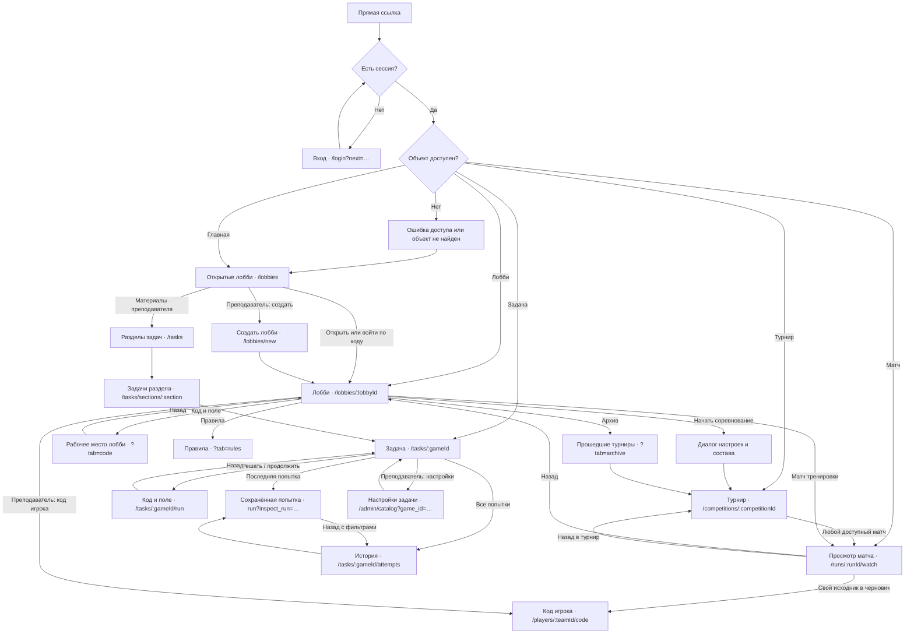
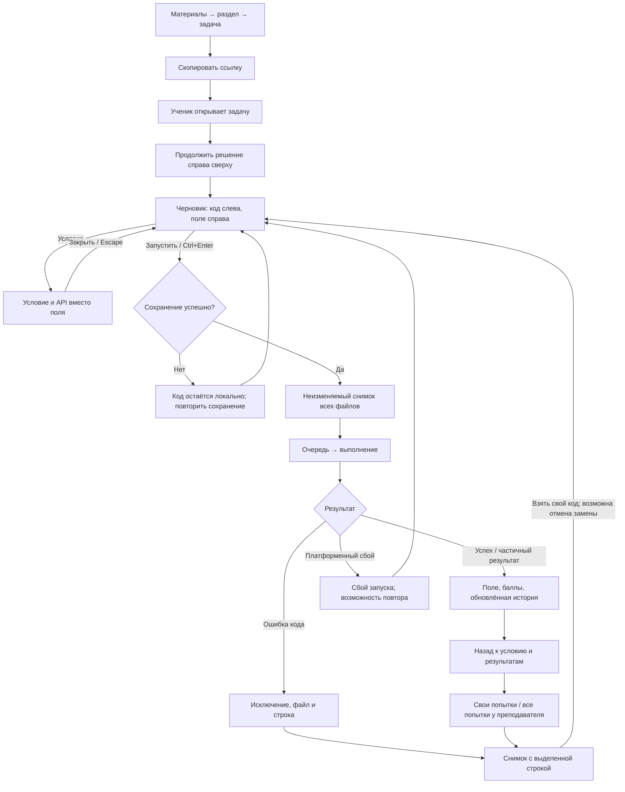
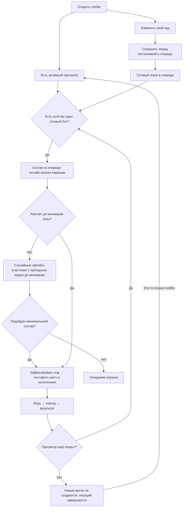
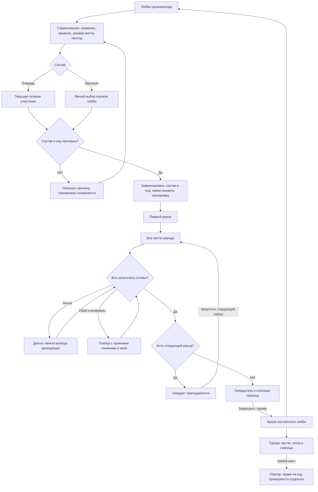
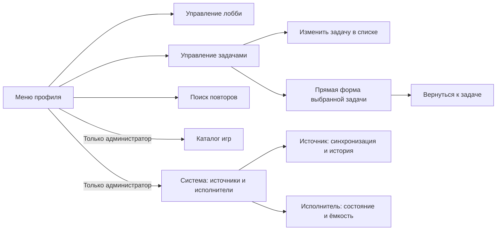

# Арена: UX-граф

Актуальная редакция: 11 ноября 2026 года. Граф описывает действующие маршруты и согласованные сценарии. Компоновка экранов и визуальные правила: [UX_SCREENS_V2.md](UX_SCREENS_V2.md). Технические границы: [UX_IMPLEMENTATION_V2.md](UX_IMPLEMENTATION_V2.md).

Главная — открытые мультиплеерные лобби. Задачи ученик открывает по ссылке. В модели нет классов, занятий и внутренних выданных заданий. Передача оценок в codingprojects отложена; внешний вход сохранён. Основной участник — один аккаунт с одним или несколькими файлами игрового бота. Совместное владение командой несколькими аккаунтами в этот граф не входит.

## Карта страниц

Просмотр записи и чтение исходника — разные права. Ученик может смотреть любой доступный матч турнира, но читает только свой код и свои приватные логи. Преподаватель и администратор разбирают исходники участников. Переход из просмотра назад сохраняет исходную задачу, лобби или турнир; история попыток сохраняет фильтры.

## Страницы, вкладки и роли

| Экран / маршрут | Ученик | Преподаватель | Администратор |
| --- | --- | --- | --- |
| `/login` | Вход с возвратом по ссылке | То же | То же |
| `/lobbies` | Открытые лобби; приглашение по коду | То же; создание лобби | То же |
| `/lobbies?all=1` | Не показывается | Управление доступными лобби | Управление лобби |
| `/tasks` | Не показывается | Разделы материалов | То же |
| `/tasks/sections/:section` | Не показывается | Задачи выбранного раздела | То же |
| `/tasks/:gameId` | Условие, личный результат, рейтинг, свои попытки | Все попытки; фильтр по ученику; ссылка и настройки | То же |
| `/tasks/:gameId/run` | Свой код, поле, запуск, условие/API | Свой демонстрационный код | То же |
| `run?inspect_run=…` | Свой неизменяемый исходник и ошибка | Выбранная попытка ученика | То же |
| `/tasks/:gameId/attempts` | Своя история и фильтры | История задачи с выбором ученика | То же |
| `/admin/catalog?game_id=…` | Недоступно | Прямая форма настроек одной задачи | То же |
| `/admin/catalog` | Недоступно | Поиск, состояние задач, редактирование, видимость разделов | То же |
| `/lobbies/new` | Недоступно | Игра, название, доступ, лимит | То же |
| `/lobbies/:lobbyId` | Участники и свои тренировочные матчи | Все тренировочные матчи и управление | То же; добавление демонстрационных ботов |
| Лобби `?tab=code` | Свой код и поле; постановка в очередь | Свой код при участии в лобби | То же |
| Лобби `?tab=game` | Текущая трансляция | То же | То же |
| Лобби `?tab=rules` | Условие и API игры | То же | То же |
| Лобби `?tab=competition` | Текущий турнир | Управление текущим турниром | То же |
| Лобби `?tab=archive` | Доступные прошедшие турниры | Архив лобби | То же |
| `/competitions/:competitionId` | Все/свои матчи, сетка, таблица | То же; раунды, ничьи, повторы после сбоя, модерация | То же |
| `/runs/:runId/watch` | Доступный повтор; только свой исходник | Любой разрешённый исходник матча | То же |
| `/players/:teamId/code` | Свой черновик с явным сохранением | Свой черновик или чужой код только для чтения | То же |
| `/replays` | Недоступно | Служебный поиск повторов | То же |
| `/games` | Недоступно | Недоступно; выбор игры есть в создании лобби | Служебный каталог игр |
| `/games/:gameId/docs` | Документация доступной игры или задачи | То же | То же |
| `/admin/game-sources` | Недоступно | Недоступно | Источники, сборки, история синхронизации, исполнители |

`/workspace/:teamId` и `/runs/:runId` — совместимые переадресации, а не дополнительные экраны. `/competitions` ведёт к лобби. Матчи, сетка и таблица — вкладки одного турнира; итоги остаются на той же странице. Архив — вкладка постоянного лобби. Форма выбора состава — диалог, а не отдельная обязательная страница.

## Учебная задача

Условие занимает левую колонку страницы задачи. Кнопки преподавателя сгруппированы рядом с заголовком. Правая колонка начинается с решения и личного результата, затем содержит лидерборд и последние попытки. Преподаватель выбирает ученика кликом в рейтинге. Полная история открывается без потери этого выбора.

Ошибка обозначена значком в первой узкой колонке и текстом. Над полем сразу видны исключение и переход к строке, подробности раскрываются отдельно. Снимок подписан временем захвата кода; время запуска показано отдельно. Технические `v3/v4` в пользовательском интерфейсе не используются.

## Тренировка, присутствие и очередь

- Зритель не обязан стоять в очереди и участвовать в матче. Просмотр преподавателем или учеником достаточен для готовых ботов.
- Присутствие просмотра передаётся через Redis между API и отдельным matchmaker. Срок активности — 20 секунд; скрытая вкладка прекращает его продлевать.
- Обычный игрок после 10 минут офлайна снимается с очереди. Возвращение не ставит его обратно автоматически. Явное повторное вступление начинает новый интервал ожидания.
- Добавленные администратором демонстрационные боты сохраняют готовность. У них нет человеческого онлайн-статуса: в списке они подписаны как боты. При отсутствии зрителей они не расходуют ресурсы на новые матчи.
- Новые матчи требуют хотя бы одного готового участника. Совсем неготовые офлайн-участники только дополняют недостаточный состав; матч не раздувается до максимума ради заполнения.
- Для закрытого лобби сначала проверяется доступ: запрещённый просмотр не продлевает присутствие.

## Соревнование и архив

Во время турнира состав не зависит от присутствия. Вход зрителя не запускает следующий раунд и не возобновляет тренировку. Отмена, таймаут и сбой платформы не назначают проигравшего автоматически. Ручная ничья требует выбора; первый игрок не подставляется победителем по умолчанию. Повтор сохраняет исходные условия, а неудачная попытка остаётся доступна для диагностики.

Матчи до пяти участников показывают имена непосредственно. При большем составе строка содержит число игроков и личный результат; раскрытие показывает весь состав с местами и очками. «Все / мои» фильтрует список, но не запрещает просмотр чужого матча турнира.

## Служебные переходы и контекстные меню

В карточке остаётся главное действие. Редкие настройки и группы второстепенных действий открываются через «⋯»: управление лобби, действия участника турнира, история/отключение источника, смена состояния исполнителя. Опасные действия подписаны и выделены цветом. Меню открывается с клавиатуры, поддерживает стрелки и Escape, закрывается снаружи и помещается в экран.

## Диалоги и состояния, входящие в проверку

| Контекст | Состояния и переходы |
| --- | --- |
| Вход / приглашение | Нет сессии, ошибка входа, неверный код, закрытое или заполненное лобби, возврат по `next` |
| Настройки задачи | Загрузка, сохранённая форма, изменения, сохранение, ошибка валидации/запроса, возврат к той же задаче |
| Рабочее место | Черновик, сохранение, ошибка сохранения, очередь, выполнение, отмена, результат, ошибка кода, неизменяемый разбор |
| Код / поле | Условие и API, меню файла, шаблон, отмена замены, переключение файла, изменение ширины, мобильные вкладки |
| Лобби | Подключение, очередь, выход, ожидание зрителя, игра, повтор, результат, пауза, остановка, правила, архив |
| Настройки лобби | Название, доступ, код и лимит; удаление остановленного лобби доступно в меню лобби и требует подтверждения |
| Выбор состава | Очередь / вручную, выбрать всех, недостаточный состав, непригодный код, ошибка старта |
| Турнир | Матчи / сетка / таблица, фильтры, ожидание раунда, ничья, платформенный сбой, повтор, завершение |
| Просмотр | Загрузка, доступный повтор, недоступная запись, перемотка и скорость, игроки на телефоне, свой/чужой код |
| Система | Пустые источники, синхронизация, результат сборки, история, состояния исполнителей, ошибки операций |

Отдельных экранов передачи оценок, класса, занятия, выдачи задания, настраиваемой шкалы оценивания и дублирующей страницы итогов нет. Состояния загрузки используют змейку; ожидание команды преподавателя — статичную паузу. Пояснения к устройству платформы остаются в документации, а не занимают рабочую область.
