# UX-граф платформы: задачи и соревнования

> При внедрении передача оценок codingprojects отложена по решению пользователя. Актуальные маршруты и границы реализации: [UX_IMPLEMENTATION_V2.md](UX_IMPLEMENTATION_V2.md).

Статус: предложение целевого UX по обсуждению от 8 ноября 2026 года. Документ описывает проектируемое поведение, а не перечень уже реализованных возможностей. Актуальная редакция учитывает уточнения: главная — открытые мультиплеерные лобби; задачи доступны ученикам по ссылке; боковое меню отсутствует; классов и занятий в модели нет.

## 1. Границы и обозначения

Два основных сценария:

1. Преподаватель выдаёт учебную задачу по ссылке или через codingprojects; ученик решает её, изучает визуализацию и получает результат.
2. Организатор создаёт лобби; участники тренируются, затем проходят соревнование с ручным запуском раундов.

В схемах прямоугольник обозначает страницу или действие, ромб — проверку, скруглённый узел — состояние. Подграфы объединяют части сценария, а не обязательно отдельные страницы. Переходы между страницами не отменяют выполняющийся запуск.

Роли:

- **Ученик** работает со своими черновиками, попытками и матчами.
- **Преподаватель** выбирает материал, делится ссылкой на задачу и разбирает попытки задач, к которым имеет доступ.
- **Организатор** управляет конкретным лобби и соревнованиями в нём; эту роль может выполнять преподаватель или администратор.
- **Системный администратор** обслуживает платформу и материалы; техническое администрирование не входит в основную навигацию ученика.

Основа модели:

- **Задача каталога** — переиспользуемый материал с версией правил, движка и API.
- **Прямая ссылка на задачу** открывает саму задачу. Отдельные сущности выданного задания, класса и занятия не создаются. При переходе из codingprojects может передаваться контекст внешнего задания для отправки оценки.
- **Лобби** — постоянное место события, объединяющее тренировку, соревнование и архив.
- **Черновик** принадлежит пользователю и конкретной задаче или лобби. Открытие другой активности не меняет его незаметно.
- **Попытка или матч** ссылается на неизменяемый набор: запущенный код всех ролей, версию игры, поле или набор проверок и результат.
- **Состав матча** — список участников с номером на поле, состоянием, очками и итоговым местом; размер определяется игрой и не ограничивается парой. Снимки кода подписаны временем сохранения, отдельно от времени начала матча. Внутренний идентификатор снимка остаётся неизменяемым.
- **Участник** в базовом графе — один аккаунт, который может писать несколько игровых ролей. Команды из нескольких аккаунтов требуют отдельного согласования сценария членства и прав.

Рабочие допущения для обсуждения: после закрытия приёма новых зачётных попыток остаётся доступ к результатам; разрешение правок между раундами задаёт организатор заранее. Дополнение пользователя: очередь тренировки учитывает присутствие, после 10 минут офлайна участник из неё исключается; офлайн-участники могут дополнять состав матча. Организатор выбирает состав соревнования из текущей очереди либо вручную; все проведённые соревнования сохраняются в архиве лобби.

## 2. Общая карта страниц

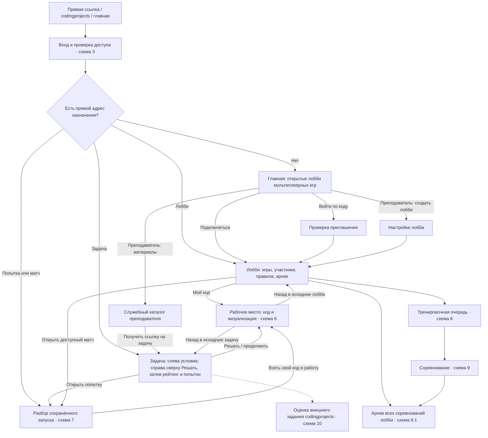

Главная одинакова по смыслу для обеих ролей: открытые лобби. Задачи не появляются на главной, в недавних элементах или в ученическом каталоге. Преподавателю доступен отдельный служебный каталог материалов. Бокового меню нет: в верхней строке остаются логотип, «Лобби», вход по коду и преподавательские материалы. Назад из редактора и разбора ведёт в исходную задачу или лобби с сохранением фильтров.

## 3. Вход, прямые ссылки и доступ

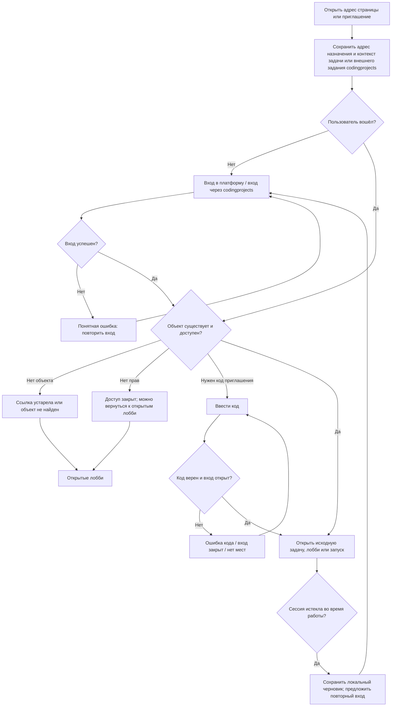

Доступ проверяется к самому объекту и его данным: знание адреса чужой попытки не даёт права читать код или логи. Возврат после входа сохраняет назначение codingprojects; локальный черновик восстанавливается только для того же пользователя и активности.

## 4. Преподаватель: материалы, ссылки и создание лобби

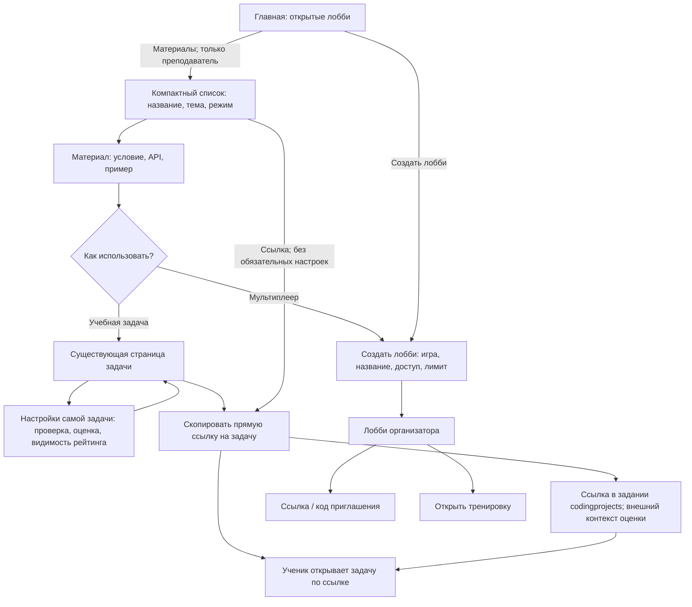

Получение ссылки не создаёт отдельного внутреннего задания или списка учеников. Сроки и состав внешнего задания codingprojects остаются в codingprojects. Платформа обрабатывает контекст перехода для передачи оценки. Настройки соревнования включают формат, размеры матчей, проход, ничьи и политику кода; состав выбирается перед стартом из очереди или вручную.

## 5. Страница задачи: условие слева, действие и результаты справа

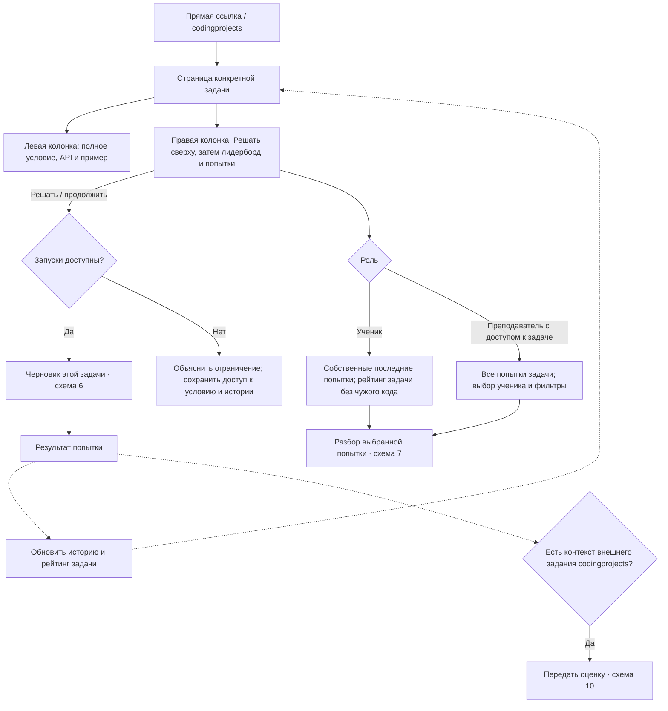

Условие занимает всю левую колонку. Там находятся название, критерии, интерфейс функции и пример. Правая колонка начинается с кнопки решения, личного результата и статуса передачи оценки; ниже объединяет лидерборд и последние попытки: у ученика свои, у преподавателя все по этой задаче. Клик преподавателя по имени открывает историю с фильтром по ученику. Никакого списка «учеников класса без попыток» нет: у задачи нет внутреннего состава класса или занятия.

## 6. Рабочее место: черновик и выполнение

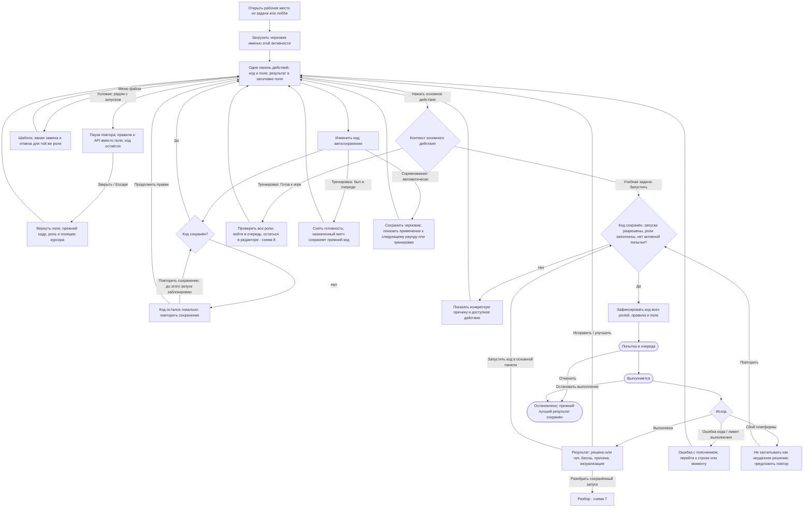

Правки во время выполнения меняют следующий черновик, а не код текущего запуска. При наличии активной попытки повторный запуск недоступен, но можно перейти к ней. При работе через codingprojects правила зачёта и сроки берутся из внешнего задания; отдельный срок для класса внутри платформы не вводится.

Уход из редактора не отменяет запуск. После завершения он появляется в истории и обновляет результат, рейтинг и статус оценки; исходник и время относятся к запущенному снимку. Демонстрация преподавателя не добавляется к ученическим попыткам. Ошибка ведёт прямо к строке кода. Запуск один — в верхней панели; под полем находятся только действия воспроизведения.

Рабочее место не содержит полных таблиц участников, истории и рейтинга. Условие и API доступны по кнопке, подробные события и переменные — в раскрываемой панели. При ошибке над полем сразу видны исключение и переход к строке; подробная трассировка раскрывается отдельно. Над рабочей областью одна панель: возврат, название, тихий индикатор сохранения, «Условие», основное действие. Шаблон находится в меню файла; роль — в строке файла. Общая шапка и отдельные служебные строки скрыты. На узком экране код и поле переключаются с сохранением состояния. Сохранение, вычисление запуска и воспроизведение записи остаются разными действиями.

## 7. Разбор попытки или просмотр матча

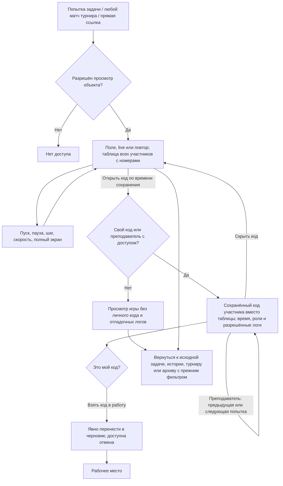

В учебной задаче ученик открывает собственные попытки, преподаватель — разрешённые попытки задачи. В турнире и его архиве ученик может смотреть любой матч, включая матчи без своего участия. Доступ к просмотру игры не раскрывает чужой исходный код и личные логи. Код своей стороны остаётся доступен владельцу; преподавателю доступны разрешённые данные участников своего лобби.

Открытие запуска не меняет черновик. Повторный запуск создаёт новую попытку. Если игра ещё идёт, отображается текущий статус; окончательный результат появляется после завершения. Если запись недоступна, сохраняется доступ к результату и разрешённым данным.

Список матчей одинаково работает для 2, 8 и 16 игроков. Сначала показана компактная сводка: время начала, статус, победитель или число оставшихся в игре, количество участников и собственный результат. Нажатие на количество раскрывает весь состав с местами и очками без перехода. «Смотреть» открывает поле и таблицу участников. При совпадении очков место общее; при сбое очки не начисляются. Номера на поле связаны с участниками независимо от места.

Список матчей — основная вкладка текущего турнира, общая таблица вынесена отдельно. В полном составе время кода не увеличивает высоту каждой строки: у преподавателя оно в колонке, у ученика свой снимок открывается из заголовка. Страницы и карточки не растягиваются ради одинаковой высоты; размеры и ритм описаны в UX_SCREENS_V2.md.

Время сохранения кода показывается с секундами и относится к использованному снимку, а не к актуальному черновику. Дата берётся из контекста запуска, все времена форматируются в одном часовом поясе. Служебные v3/v4 не выводятся, а внутренние идентификаторы сохраняют точность ссылок.

## 8. Лобби: подключение, очередь и тренировка

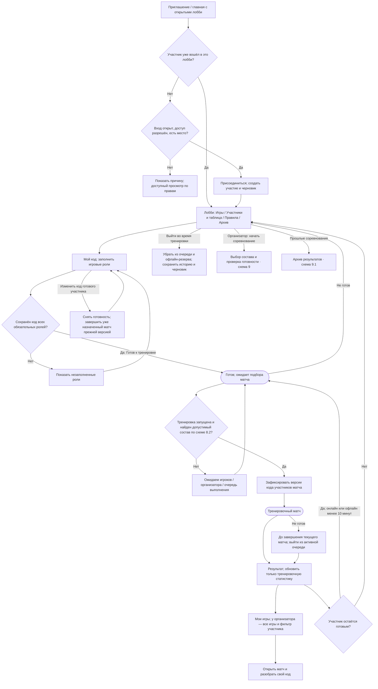

В шапке постоянно видны фаза, готовность, присутствие и состояние участия. В тренировке ученик видит свои матчи, в том числе сыгранные его кодом для доукомплектования во время офлайна; организатор — все и отдельного участника. Таблица общая в пределах лобби. Изменение кода готового участника явно снимает готовность; уже зафиксированный состав и код назначенного матча сохраняются.

Пауза организатора останавливает новые назначения; состояние текущих матчей объясняется на экране. Возобновление возвращает подбор. Закрытие или удаление лобби не должно незаметно уничтожать историю; правила хранения вынесены в схему 11.

### 8.1. Присутствие и автоматический выход из очереди

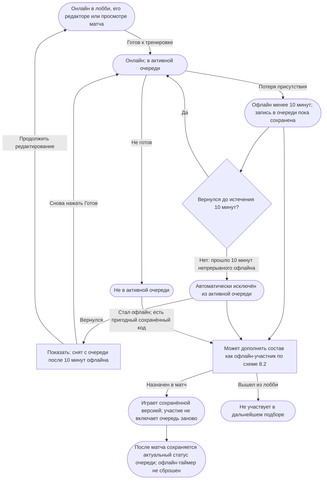

Таймер отсчитывается по отсутствию присутствия, а не с момента нажатия «Готов». Краткий обрыв соединения не сбрасывает участие немедленно. Просмотр своего матча и работа в редакторе лобби учитываются как присутствие. Автоматическое снятие не отменяет уже назначенный матч и не запускает новый.

Возвращение после автоматического снятия не включает очередь заново без действия ученика. Офлайн-участие для доукомплектования не восстанавливает статус «в очереди» и не сбрасывает таймер. В интерфейсе очереди отдельно показываются присутствие и готовность: офлайн-резерв не изображается готовыми онлайн-игроками. Правило использования сохранённого кода офлайн объясняется в правилах лобби; выход из лобби исключает из обоих механизмов подбора.

### 8.2. Подбор тренировочного матча с экономией ресурсов

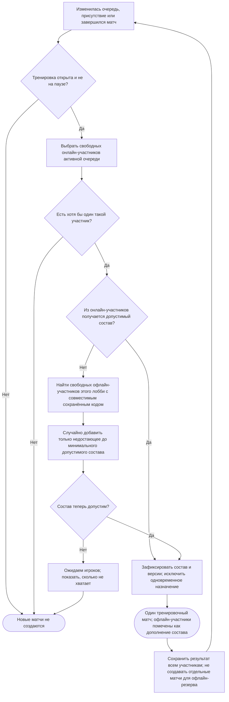

Правила подбора:

- Приоритет имеют онлайн-участники в очереди. Онлайн-участник, который не нажал «Готов», не добавляется случайно.
- Офлайн-резерв используется только при недостатке онлайн-участников для минимально допустимого матча. Он не заполняет свободные места до максимума без необходимости.
- Кандидат должен оставаться участником лобби, иметь сохранённый код всех обязательных ролей, совместимый с версией игры, и не участвовать в другом назначенном или выполняющемся матче. Локальный несохранённый черновик не используется.
- Матч требует хотя бы одного онлайн-участника активной очереди. Полностью офлайн-составы не запускаются автоматически: иначе ресурсосбережение превратится в бесконечную симуляцию отсутствующих игроков.
- После завершения подбора присутствие может измениться; уже назначенный матч доигрывается. Перед каждым следующим назначением присутствие проверяется заново.
- Подбор не создаёт новые запуски от каждого обновления страницы: один участник резервируется не более чем в один активный матч.
- Ограничение онлайн-состава и правило 10 минут относятся к тренировке. Ручной запуск соревнования работает с выбранным составом независимо от текущего присутствия.

## 9. Соревнование: запуск и ручное продвижение раундов

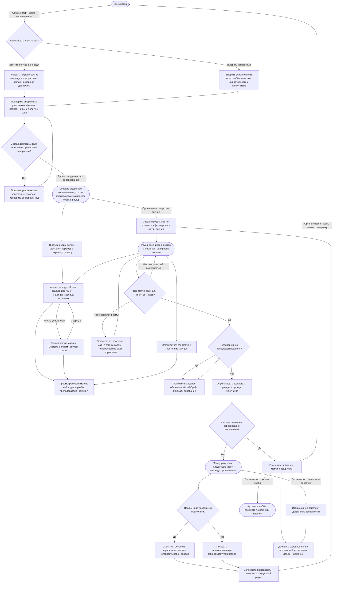

Правила фаз:

- Старт соревнования и запуск первого раунда — разные действия. После проверки состава участники видят, что регистрация закрыта и соревнование ожидает старта.
- «Все в очереди» означает именно состав очереди на момент выбора, включая ещё не снятых по 10-минутному правилу офлайн-участников. Присутствие каждого видно в предпросмотре; офлайн-резерв сам по себе в этот состав не включается. Если очередь изменилась до подтверждения, организатор видит изменение и обновляет выбор явно.
- При ручном выборе можно включать участников вне очереди и офлайн. Для каждого проверяется пригодность кода; отсутствующие обязательные роли объясняются до старта, участники не отбрасываются молча.
- После подтверждения состав не меняется из-за ухода в офлайн, истечения 10 минут или изменений тренировочной очереди. Случайные офлайн-участники в зачётные матчи не подставляются.
- Невыбранные участники видят статус «Вне состава», сохраняют черновик и могут смотреть все матчи, таблицу и архив турнира. Обычный тренировочный подбор в этом лобби на время соревнования приостановлен.
- Каждый следующий раунд запускает организатор. Завершение матчей само по себе его не запускает.
- Внутри запущенного раунда матчи могут назначаться и выполняться автоматически.
- Тренировочный рейтинг, текущая турнирная таблица и итоги прошлых соревнований — разные наборы результатов.
- При фиксации кода на весь турнир повторно используется исходная версия; при разрешённых правках между раундами следующий раунд фиксирует обновлённую версию.
- Ученик не останавливает зачётный матч своей кнопкой редактора. Выход со страницы не снимает его с соревнования. Снятие участника организатором фиксируется отдельным решением по объявленным правилам.
- Ошибка пользовательского кода и превышение лимита обрабатываются по правилам игры; сбой платформы требует восстановления и не считается автоматически поражением.
- Повтор зачётного матча не удваивает очки: предыдущая техническая попытка остаётся в истории как незачётная, а матч получает один действующий итог.
- Для кругового формата «проход» может отсутствовать; таблица и критерий завершения соответствуют выбранному формату, сетка не навязывается всем турнирам.

### 9.1. Постоянный архив соревнований лобби

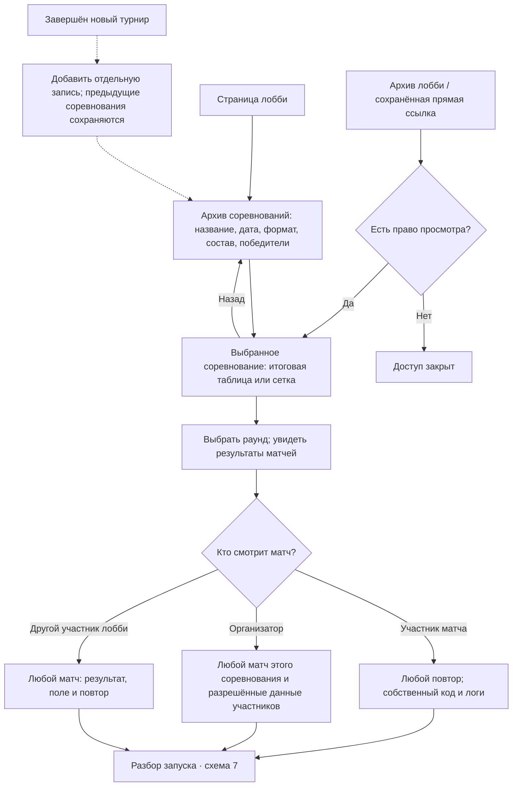

Архив появляется в навигации лобби после первого соревнования. Он содержит все завершённые соревнования, а не только последнее. Внутри сохраняются состав, правила и версия игры, все раунды, результаты матчей, использованные версии кода и доступные записи. Тренировочная очистка не удаляет зачётные матчи и архив.

Новое соревнование, новая тренировка и изменение черновиков не переписывают прошлые результаты. На конкретное соревнование, раунд и матч можно дать устойчивую ссылку. Участник сохраняет доступ к результатам своего соревнования после выхода из лобби или его закрытия; при исключении по основаниям доступа применяется отдельное явное решение, а не случайная потеря записи участия.

## 10. codingprojects: передача оценки

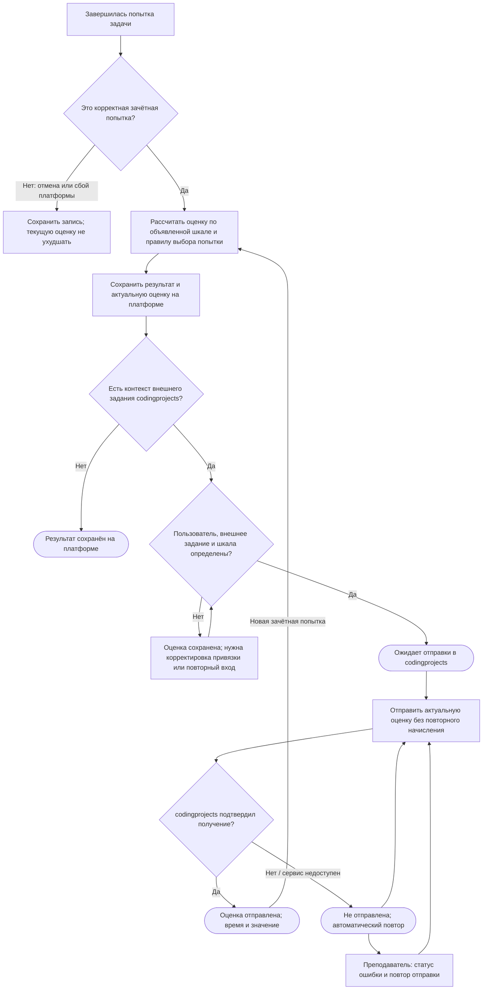

Статус передачи не подменяет статус решения. Ученику не требуется повторять успешное решение из-за сетевой ошибки. При повторной отправке передаётся актуальная оценка; запоздавший ответ старой отправки не откатывает новую. Правило «последняя попытка» может менять оценку вниз, если это заранее объявлено; отмена и сбой платформы такими попытками не считаются.

## 11. Управление задачами, закрытие лобби и служебные сценарии

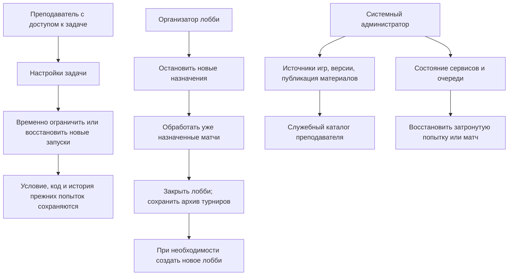

Ограничение запуска задачи не создаёт новое задание или занятие. Новая версия игры не переписывает старые попытки и турниры. Закрытие лобби и физическое удаление — разные операции; учебная история и результаты остаются доступны по прежним правам. Сроки хранения — отдельная административная политика.

## 12. Содержимое экранов и границы доступа

| Экран | Ученик | Преподаватель с доступом к задаче / организатор лобби |
| --- | --- | --- |
| Открытые лобби | Открытые мультиплеерные лобби и вход по коду; задачи открываются по ссылке | Те же открытые лобби, создание лобби и отдельный служебный каталог |
| Каталог материалов | Не входит в основную навигацию | Поиск и выбор материала, просмотр условия и примера, выдача задачи или создание лобби |
| Задача | Слева условие; справа сверху Решать и личный результат, затем рейтинг и собственные попытки | То же плюс все попытки этой задачи, фильтр по ученику, настройки и ссылка |
| История попыток задачи | Только свои; время, результат, баллы, переход к разбору | Все попытки доступной задачи; по времени или ученику, фильтры результата и ошибок |
| Лобби: тренировочные игры | Свои текущие и завершённые матчи, включая участие офлайн для дополнения состава | Все матчи лобби, фильтр участника, текущий статус раунда |
| Лобби: участники и таблица | Состав, присутствие, готовность, тренировочный рейтинг или турнирная таблица в зависимости от фазы | Дополнительно управление составом, выбор участников соревнования из очереди или вручную, блокеры старта |
| Лобби: условие и правила | Правила игры, API, формат и тай-брейк, политика кода | Настройка до фиксации; последующие изменения не переписывают уже проведённые раунды |
| Рабочее место | Черновик, выбор игровых ролей, запуск задачи или готовность к тренировке, визуализация, ошибки | Демонстрация и помощь; просмотр чужого кода не заменяет личный черновик преподавателя |
| Разбор запуска | Сохранённый свой код и логи, результат, повтор; код соперников закрыт | Разрешённый код и логи участников доступной задачи или своего лобби, переходы по попыткам выбранного ученика |
| Архив соревнований лобби | Все доступные прошлые соревнования и любые матчи; собственные код и логи | Все прошлые соревнования, их матчи и решения организатора |
| Интеграция codingprojects | Своя оценка и статус отправки | Контекст внешнего задания, правила шкалы, ошибки передачи и повтор отправки |
| Служебные экраны | Недоступны | Техническое администрирование — отдельные права системного администратора |

Системный администратор при необходимости получает технический доступ по своей роли; это не означает, что любой преподаватель видит все задачи и код всей платформы. Просмотр чужого кода преподавателем не включает его редактирование: совместное исправление кода ученика требует отдельного явно обозначенного режима.

## 13. Постоянные и скрываемые элементы рабочего места

| Постоянно | По запросу | На странице задачи или лобби |
| --- | --- | --- |
| Компактная строка: назад, название, Условие, запуск | Правила и API временно вместо поля | Полная история попыток и матчей |
| Редактор и роли, если их несколько | Подробные события, состояние и переменные | Лидерборд и турнирная таблица |
| Индикатор сохранения в общей строке | Меню файла: шаблон и отмена замены | Состав и готовность других участников |
| Контекстное основное действие | Дополнительные параметры выполнения, если они нужны игре | Приглашения и управление доступом |
| Визуализация и управление повтором | Расширенная статистика и технические сведения | Настройки задачи или лобби и управление раундами |
| Краткий результат и компактная консоль | Полноэкранная демонстрация | Архив соревнований |
| В лобби — компактный статус фазы и своей версии | Код запущенной версии без подмены черновика | Привязка и обслуживание интеграции |

На узком экране «Код» и «Поле» переключают одну рабочую область. «Условие» временно открывает справку в той же области. Переключение представления сохраняет код, выбранную роль, положение повтора и состояние запущенной попытки.

## 14. Требования и проектные допущения

Явные требования пользователя отмечены отдельно. Остальные пункты — предлагаемые решения для целостного UX; они описывают основу проектирования, а не выполненные изменения приложения.

1. Задача — самостоятельная сущность с прямой ссылкой; классов, занятий и внутренних выданных заданий нет.
2. Отдельный черновик на задачу или лобби; перенос кода между активностями выполняется явным действием.
3. Видимость лидерборда задачи настраивается преподавателем; код других учеников ему не сопутствует.
4. Старт каждого раунда ручной; матчи внутри запущенного раунда выполняются автоматически.
5. Политика кода определяется до старта: фиксация на весь турнир либо правки между раундами с фиксацией следующей версии.
6. Во время тренировки снятие готовности исключает из активной очереди, а текущий матч доигрывается прежней версией. По требованию пользователя офлайн-участник с пригодным сохранённым кодом может дополнять состав даже вне очереди; выход из лобби исключает и эту возможность.
7. В базовой модели один участник — один аккаунт с набором игровых ролей; совместные команды людей не включены автоматически.
8. Оценка случайных задач должна опираться на заранее объявленную проверку: единое поле или сопоставимую серию полей. Один удачный случайный запуск не должен незаметно подменять критерий задачи.
9. codingprojects получает оценку конкретного внешнего задания и пользователя; доставка оценки повторяется независимо от выполнения решения.
10. Турниры лобби архивируются; история попыток задач сохраняется; сроки хранения и удаление согласуются отдельно.
11. Учтённое требование: после 10 минут непрерывного офлайна участник снимается с тренировочной очереди; возвращение не включает его заново автоматически.
12. Интерпретация ресурсосбережения: офлайн-резерв используется только для дополнения матча с хотя бы одним онлайн-участником очереди и только до допустимого минимального состава.
13. Учтённое требование: перед соревнованием организатор выбирает всех из текущей очереди либо конкретных участников лобби. Зафиксированный состав не зависит от последующего присутствия.
14. Учтённое требование: все проведённые соревнования лобби сохраняются отдельно и доступны через архив, включая результаты предыдущих турниров после старта нового.

15. Действие решения задачи находится справа сверху, над рейтингом и попытками; на узком экране оно доступно до длинного условия.
16. Рабочее место использует одну компактную панель. Условие открывается вместо поля, не меняя код, роль и позицию повтора; шаблон доступен из меню файла.

17. В текущем соревновании и архиве ученик может смотреть любой матч. Список имеет фильтр «Все / Мои». Код и личные логи доступны владельцу и преподавателю с соответствующим доступом.
18. Описания устройства интерфейса вынесены из продукта в документацию; внутри остаются данные, действия, значимые статусы и ошибки.
19. Матч поддерживает произвольный разрешённый состав. В списке показана сводка, полный состав раскрывается; таблица турнира находится на отдельной вкладке. В макетах проверяются 2, 8 и 16 игроков.
20. Время сохранения использованного кода и время начала запуска — разные значения. Пользователь видит время с нужной точностью вместо служебной нумерации снимков; изменение черновика не меняет подпись старого матча.
