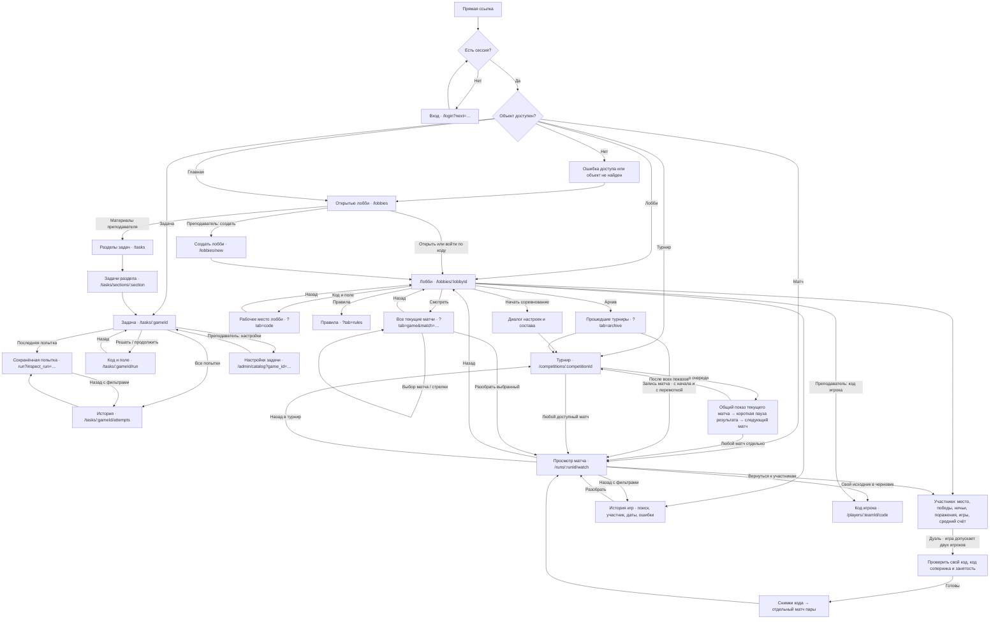
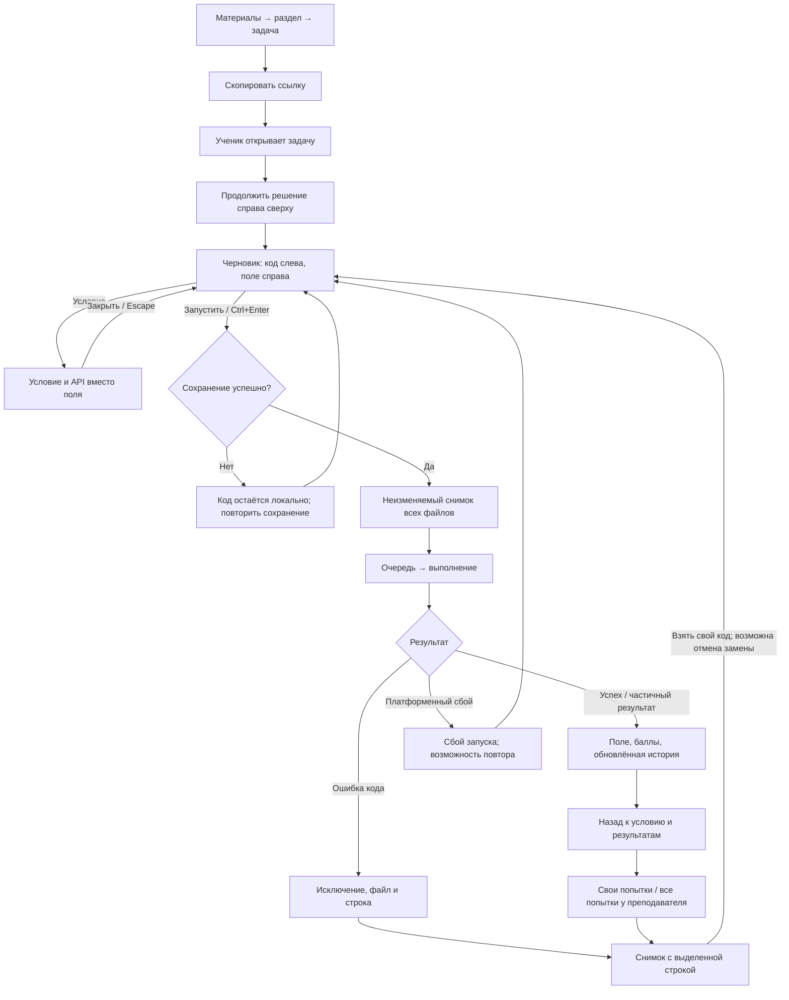
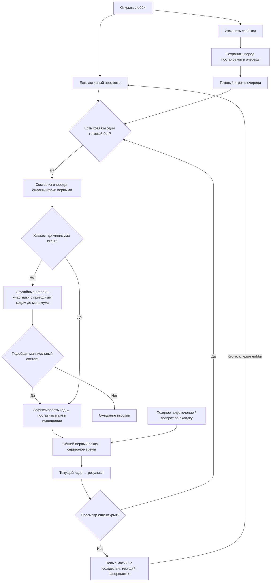
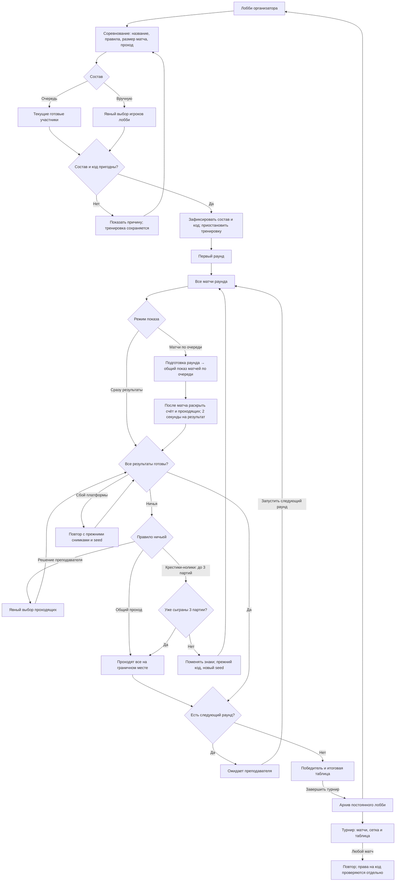
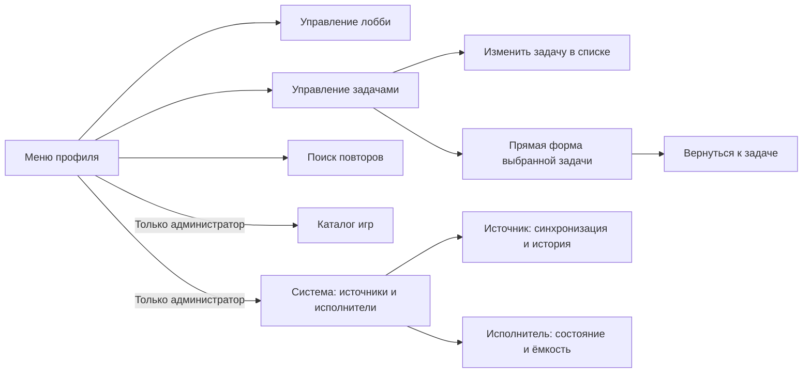
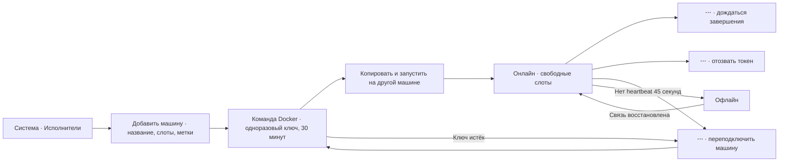

# Арена: UX-граф

Актуальная редакция: 13 ноября 2026 года. Граф описывает действующие маршруты и согласованные сценарии. Компоновка экранов и визуальные правила: [UX_SCREENS_V2.md](UX_SCREENS_V2.md). Технические границы: [UX_IMPLEMENTATION_V2.md](UX_IMPLEMENTATION_V2.md).

Главная — открытые мультиплеерные лобби. Задачи ученик открывает по ссылке. В модели нет классов, занятий и внутренних выданных заданий. Передача оценок в codingprojects отложена; внешний вход сохранён. Основной участник — один аккаунт с одним или несколькими файлами игрового бота. Совместное владение командой несколькими аккаунтами в этот граф не входит.

## Карта страниц

Просмотр записи и чтение исходника — разные права. Ученик может смотреть любой доступный матч турнира, но читает только свой код и свои приватные логи. Преподаватель и администратор разбирают исходники участников. Переход из просмотра назад сохраняет исходную задачу, лобби или турнир; история попыток сохраняет фильтры.

Номер матча берётся из полного состава раунда и сохраняется при фильтрах «Мои» и по участнику. После завершения турнира просмотр записи открывается с начала и допускает перемотку, включая быстрый переход в архив сразу после определения победителя. Чтение своего снимка кода доступно ученику и для запуска, созданного преподавателем; права управления запуском проверяются отдельно.

## Страницы, вкладки и роли

| Экран / маршрут | Ученик | Преподаватель | Администратор |
| --- | --- | --- | --- |
| `/login` | Вход с возвратом по ссылке | То же | То же |
| `/lobbies` | Открытые лобби; приглашение по коду | То же; создание лобби | То же |
| `/lobbies?all=1` | Не показывается | Управление доступными лобби | Управление лобби |
| `/tasks` | Не показывается | Разделы материалов | То же |
| `/tasks/sections/:section` | Не показывается | Задачи выбранного раздела | То же |
| `/tasks/:gameId` | Условие, личный результат, рейтинг, свои попытки | Все попытки; фильтр по ученику; ссылка и настройки | То же |
| `/tasks/:gameId/run` | Свой код, поле, запуск, условие/API | Свой демонстрационный код | То же |
| `run?inspect_run=…` | Свой неизменяемый исходник и ошибка | Выбранная попытка ученика | То же |
| `/tasks/:gameId/attempts` | Своя история и фильтры | История задачи с выбором ученика | То же |
| `/admin/catalog?game_id=…` | Недоступно | Прямая форма настроек одной задачи | То же |
| `/admin/catalog` | Недоступно | Все задачи, поиск, редактирование метаданных | То же |
| `/lobbies/new` | Недоступно | Игра, название, доступ, лимит | То же |
| `/lobbies/:lobbyId` | Свои игры, «Мой код», готовность | Все тренировочные игры, фильтр участника, приглашение и старт турнира | То же |
| Лобби `?tab=participants` | Участники, присутствие, очередь, тренировочная статистика | То же; переход к играм участника и его коду | То же; добавление ботов и удаление участника |
| Лобби `?tab=code` | Свой код и поле; постановка в очередь | Свой код при участии в лобби | То же |
| Лобби `?tab=game&match=…` | Все текущие матчи, переключение и разбор выбранного | То же | То же |
| Лобби `?tab=rules` | Условие и API игры | То же | То же |
| Лобби `?tab=competition` | Совместимая ссылка: переход на полную страницу текущего турнира | То же | То же |
| Лобби `?tab=archive` | Доступные прошедшие турниры | Архив лобби | То же |
| `/competitions/:competitionId` | Все/свои матчи, сетка, таблица | То же; раунды, ничьи, повторы после сбоя, модерация | То же |
| `/runs/:runId/watch` | Доступный повтор; только свой исходник | Любой разрешённый исходник матча | То же |
| `/players/:teamId/code` | Свой черновик с явным сохранением | Свой черновик или чужой код только для чтения | То же |
| `/replays` | Недоступно | Служебный поиск повторов | То же |
| `/games` | Недоступно | Недоступно; выбор игры есть в создании лобби | Служебный каталог игр |
| `/games/:gameId/docs` | Документация доступной игры или задачи | То же | То же |
| `/admin/game-sources` | Недоступно | Недоступно | Источники, сборки, история синхронизации, исполнители |

`/workspace/:teamId` и `/runs/:runId` — совместимые переадресации, а не дополнительные экраны. `/competitions` ведёт к лобби. Матчи, сетка и таблица — вкладки одного турнира; итоги остаются на той же странице. Архив — вкладка постоянного лобби. Форма выбора состава — диалог, а не отдельная обязательная страница.

## Учебная задача

Условие занимает левую колонку страницы задачи. Кнопки преподавателя сгруппированы рядом с заголовком. Правая колонка начинается с решения и личного результата, затем содержит лидерборд и последние попытки. Преподаватель выбирает ученика кликом в рейтинге. Полная история открывается без потери этого выбора.

Разбор с `inspect_run` доступен только для чтения с начала загрузки; ввод, автосохранение и Ctrl+Enter не изменяют сохранённый код. В лобби окно кода участника также доступно только для чтения. Изменения разрешены в отдельном рабочем редакторе.

Ошибка обозначена значком в первой узкой колонке и текстом. Над полем сразу видны исключение и переход к строке, подробности раскрываются отдельно. Снимок подписан временем захвата кода; время запуска показано отдельно. Технические `v3/v4` в пользовательском интерфейсе не используются.

## Тренировка, присутствие и очередь

В лобби четыре основные вкладки: «Игры», «Участники и таблица», «Условие и правила», «Архив». По умолчанию открыты два раздела на всю ширину: «Сейчас идут» и история прошедших игр. «Смотреть» открывает отдельный режим трансляции с выбором любого текущего матча и стрелками переключения. У турнира список охватывает текущий раунд. Активный матч не дублируется в истории. У обычного завершённого матча нет статусной плашки; ошибки выделяются отдельно. Поиск истории учитывает имя и время; доступны участник, диапазон дат, ошибки и страницы. Состояние хранится в `search`, `player`, `after`, `before`, `errors`, `page`; возврат из разбора и обновление страницы его сохраняют. Тренировочная история ограничена существующим серверным окном последних 30 матчей; турниры сохраняются отдельно в архиве. Имя участника у преподавателя ведёт к фильтру его игр. «Мой код» открывает рабочее место, «Разобрать» — матч с возвратом в исходное лобби. Создание соревнования и баннер текущего турнира ведут на `/competitions/:competitionId`; упрощённой копии управления турниром внутри лобби нет. Архив остаётся доступен при активном турнире. Список участников по умолчанию отсортирован по среднему счёту по убыванию; участники без результатов находятся в конце, при равном счёте порядок по имени. Колонка «Место» показывает позицию по среднему счёту: равные результаты получают одинаковое место, следующие позиции пропускаются (1, 1, 3). Сортировка по имени и фильтры не меняют место в общем лидерборде. У участников без результатов — прочерк. На телефоне место находится слева от имени. Рядом с поиском доступна сортировка по имени. Выбор сохраняется в ссылке (`sort=name`) при обновлении страницы и возврате; поиск и фильтр очереди работают с выбранной сортировкой. Переключатель доступен и на телефоне.

- Авторизованный зритель публичного лобби может смотреть текущий матч, даже если состав лобби уже заполнен. Автоматическое вступление при прямом просмотре не требуется; доступ к коду участников этим не открывается.
- Зритель не обязан стоять в очереди и участвовать в матче. Просмотр преподавателем или учеником достаточен для готовых ботов.
- Присутствие просмотра передаётся через Redis между API и отдельным matchmaker. Срок активности — 20 секунд; скрытая вкладка прекращает его продлевать.
- Обычный игрок после 10 минут офлайна снимается с очереди. Возвращение не ставит его обратно автоматически. Явное повторное вступление начинает новый интервал ожидания.
- Добавленные администратором демонстрационные боты сохраняют готовность. У них нет человеческого онлайн-статуса: в списке они подписаны как боты. При отсутствии зрителей они не расходуют ресурсы на новые матчи.
- Новые матчи требуют хотя бы одного готового участника. Совсем неготовые офлайн-участники только дополняют недостаточный состав; матч не раздувается до максимума ради заполнения.
- Присутствие зрителя обновляется без ожидания блокировки matchmaker. Если лобби занято, heartbeat повторяет обновление на следующем такте; чтение и поток событий продолжаются. Запрос просмотра использует кеш манифестов с проверкой изменений файлов.
- Для закрытого лобби сначала проверяется доступ: запрещённый просмотр не продлевает присутствие.

Первый показ имеет общий отсчёт: в тренировке он начинается после завершения всей пачки параллельных матчей. В режиме турнира «Сразу результаты» отдельный просмотр следует отсчёту конкретного матча; в режиме «Матчи по очереди» — сохранённому расписанию показа раунда. Новый зритель, повторное открытие и возврат из скрытой вкладки попадают на уже прошедший момент. Загрузка визуализации не перезапускает матч. Часы компьютера зрителя и его личная скорость повтора не меняют ход трансляции. Это одинаково работает внутри лобби и на полной странице матча.

В просмотре первого показа пауза, перемотка и выбор скорости недоступны; таблица показывает только данные выбранного текущего кадра. Итоговый результат появляется на последнем кадре. После показа открывается обычное управление повтором; открытый позднее архив начинается с начала и допускает свободный просмотр. Ожидание готовности отличается от идущего показа.

## Соревнование и архив

Во время турнира состав не зависит от присутствия. Вход зрителя не запускает следующий раунд и не возобновляет тренировку. Отмена, таймаут и сбой платформы не назначают проигравшего автоматически. Ручная ничья требует выбора; первый игрок не подставляется победителем по умолчанию. Повтор после сбоя сохраняет исходные условия, а неудачная попытка остаётся доступна для диагностики.

Для крестиков-ноликов доступно правило «До 3 партий, затем проходят оба». После первой и второй ничьей автоматически создаётся новая партия с перестановкой крестиков и ноликов, прежними снимками кода и новым seed. В последовательном показе переигровка начинается после показа предыдущей партии и паузы результата. Третья ничья даёт общий проход; если раунд никого не исключил, соревнование заканчивается совместным первым местом. Все партии остаются в матчах и архиве. Победа даёт 1 очко, ничья — по 0,5, поражение — 0; три ничьи дают по 1,5. Очки и проход учитываются отдельно. При счёте 0,5 у каждого участника исход партии — «Ничья»; имя одного победителя не подставляется из старых сохранённых данных или порядка сортировки.

Матчи до пяти участников показывают имена непосредственно. При большем составе строка содержит число игроков и личный результат; раскрытие показывает весь состав с местами и очками. «Все / мои» фильтрует список, но не запрещает просмотр чужого матча турнира.

## Служебные переходы и контекстные меню

В карточке остаётся главное действие. Редкие настройки и группы второстепенных действий открываются через «⋯»: управление лобби, действия участника турнира, история/отключение источника, смена состояния исполнителя. Опасные действия подписаны и выделены цветом. Меню открывается с клавиатуры, поддерживает стрелки и Escape, закрывается снаружи и помещается в экран.

## Диалоги и состояния, входящие в проверку

| Контекст | Состояния и переходы |
| --- | --- |
| Вход / приглашение | Нет сессии, ошибка входа, неверный код, закрытое или заполненное лобби, возврат по `next` |
| Настройки задачи | Загрузка, сохранённая форма, изменения, сохранение, ошибка валидации/запроса, возврат к той же задаче |
| Рабочее место | Черновик, сохранение, ошибка сохранения, очередь, выполнение, отмена, результат, ошибка кода, неизменяемый разбор |
| Код / поле | Условие и API, меню файла, шаблон, отмена замены, переключение файла, изменение ширины, мобильные вкладки |
| Лобби | Подключение, очередь, выход, ожидание зрителя, игра, повтор, результат, пауза, остановка, правила, архив |
| Настройки лобби | Название, доступ, код и лимит; удаление остановленного лобби доступно в меню лобби и требует подтверждения |
| Выбор состава | Очередь / вручную, выбрать всех, недостаточный состав, непригодный код, ошибка старта |
| Турнир | Матчи / сетка / таблица, фильтры, ожидание раунда, ничья, платформенный сбой, повтор, завершение |
| Просмотр | Загрузка, доступный повтор, недоступная запись, перемотка и скорость под полем, полный экран и Escape, игроки на телефоне, свой/чужой код, возврат с фильтрами |
| Система | Пустые источники, синхронизация, результат сборки, история, состояния исполнителей, ошибки операций |

Отдельных экранов передачи оценок, класса, занятия, выдачи задания, настраиваемой шкалы оценивания и дублирующей страницы итогов нет. Состояния загрузки используют змейку; ожидание команды преподавателя — статичную паузу. Пояснения к устройству платформы остаются в документации, а не занимают рабочую область.

Материалы преподавателя содержат все задачи, включая задачи без заполненного описания, сложности или раздела. Состояний публикации и переключателей видимости нет. Ученик открывает задачу и редактор по прямой ссылке; каталог материалов ему недоступен.

В крестиках-ноликах ошибка импорта, выполнения или неверный ход оставляют поле без изменений и пропускают ход. В просмотре над полем показаны ошибка и переход к строке сохранённого кода. Ученик видит диагностику своего бота, преподаватель — обоих. `random` разрешён только в этом игровом пакете; правила других игр не меняются.

## Дуэль из списка участников

Действие «Дуэль» доступно участнику лобби у другого игрока, если диапазон состава игры включает двух игроков. Преподаватель для этого участвует со своим ботом через существующее действие «Участвовать как игрок». Соперник может быть офлайн: запускается его сохранённый код, приглашение человеку не отправляется. Подтверждение соперника не является отдельным шагом.

После проверки кода и отсутствия активного матча создаются два связанных запуска, но вычисляется один общий матч. Очередь и готовность обоих игроков сохраняются. Повторный запрос действующей пары возвращает тот же матч. Новая дуэль не меняет пачку автоматического подбора и не перезапускает её показ. У неё свой общий первый показ; в лобби видны идущие дуэли, затем они переходят в обычную историю и учитываются в статистике. Исходники и приватные ошибки доступны только их автору и преподавателю. Во время турнира, остановки лобби или при занятости игрока новая дуэль недоступна.

Колонки «Ничьи» и «Поражения» считаются по исходам завершённых матчей. Ошибки платформы и отмена не считаются поражением. У старых удалённых игр раздельные исходы могут отсутствовать: «—» обозначает отсутствие полного итога, «≥» — известный минимум; подсказка содержит число неизвестных исходов. Неизвестный исход не подменяется ничьёй или поражением. Новые счётчики сохраняются при очистке истории.

## Внешние исполнители через интернет

Только администратор: **Система → Исполнители запусков → Добавить машину**. Ученик и преподаватель этого действия не видят.

Диалог открывается по центру, закрытие возвращает фокус в исходную кнопку. Команда хранится только в открытом диалоге; повторное подключение выпускает новый ключ и отзывает прежний токен. Отзыв токена запрещает дальнейшие обращения машины. При потере исполнителя задания возвращаются в очередь после истечения аренды; пользовательские переходы «ожидание → матч → результат/разбор» сохраняются.
